

  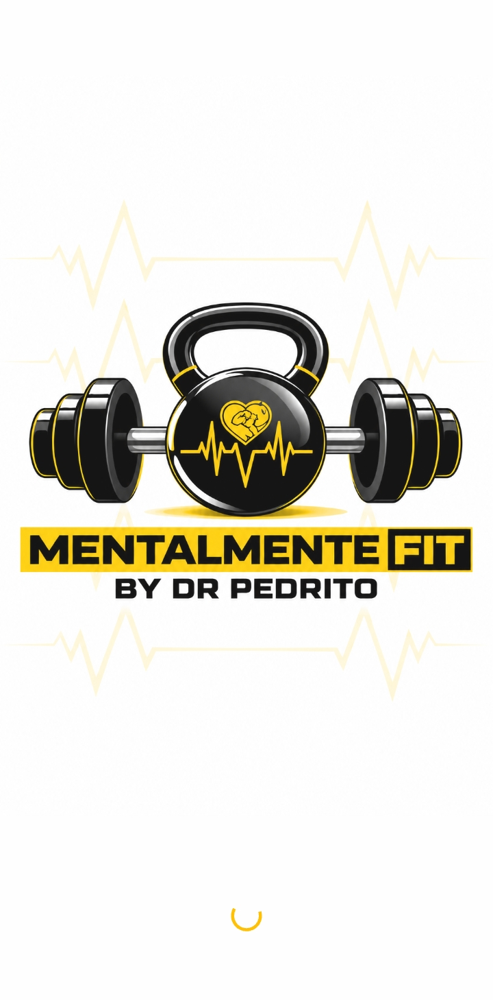

<h1 align="center">MENTALMENTE FIT</h1>

<b>by Dr. Pedrito</b> 
A premium AI-powered health, fitness and nutrition mentor app.

> This repository is a **showcase** (screenshots and feature overview). The source code is private.

---

## About

Mentalmente Fit is a mobile app (Android, built with Flutter) that combines daily health tracking, an AI health coach and direct access to a real mentor, Dr. Pedrito. It has a bold dark and yellow brand identity with a matching light theme.

| Splash (dark) | Splash (light) |
|---|---|
|  |  |

## Features

### Daily tracking
- **Calories and macros:** a progress ring plus Protein, Carbs and Fats bars against a personal daily target.
- **Steps:** live step counter from the phone sensor.
- **Water intake:** one-tap glass counter with instant response.
- **Habit checklist:** sleep, supplements and meditation.

| Login | Home (dark) | Home (light) |
|---|---|---|
| 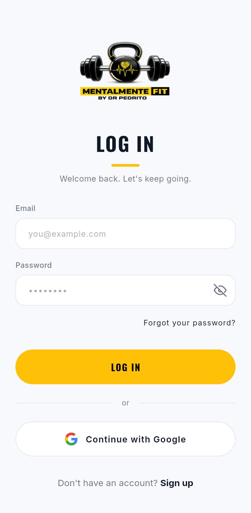 |  | 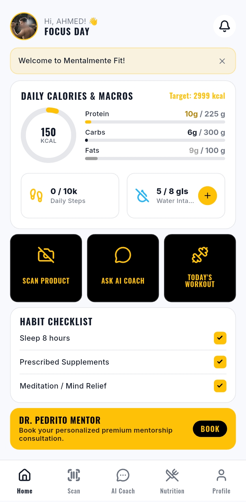 |

### Smart food scanner
- **Barcode mode:** scan a packaged product and get real nutrition data and a health score.
- **Food photo mode:** photograph a meal and AI estimates the dish, calories and macros. Results are estimates and can be added to the meal log in one tap.

| Barcode | Food photo | AI result |
|---|---|---|
| 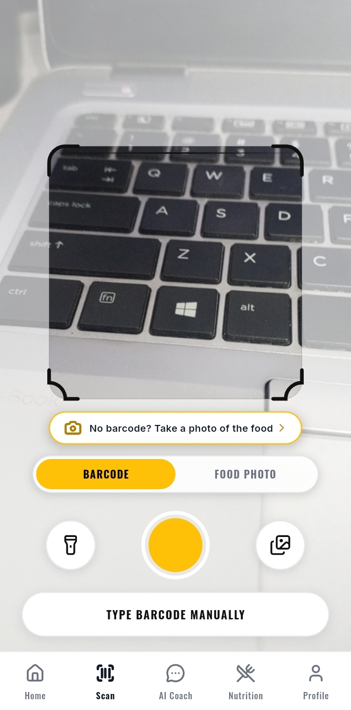 | 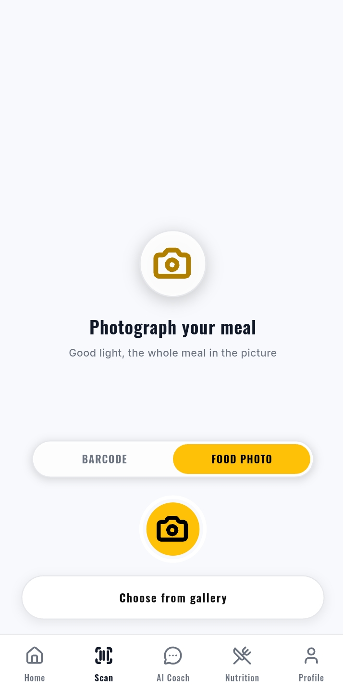 | 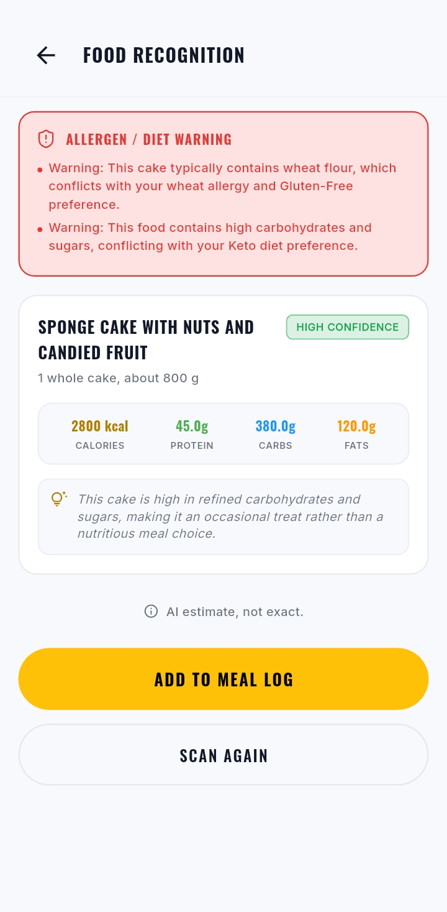 |

### Nutrition log
Meals are logged for Breakfast, Lunch, Dinner and Snacks, by search, barcode or photo, with a day-by-day view.

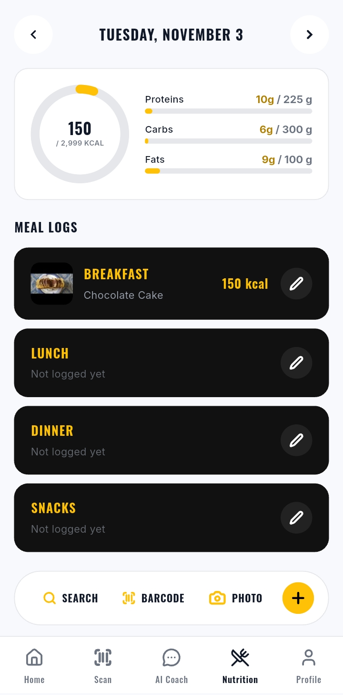

### AI Health Coach
- Chat with an AI coach in Dr. Pedrito's style, with voice input.
- Safety logic for red-flag symptoms (for example chest pain): the coach tells the user to seek urgent medical help.
- Stop generation, clear chat, and a **History** of past conversations that can be continued or deleted.

| Coach | History | Coach (light) |
|---|---|---|
| 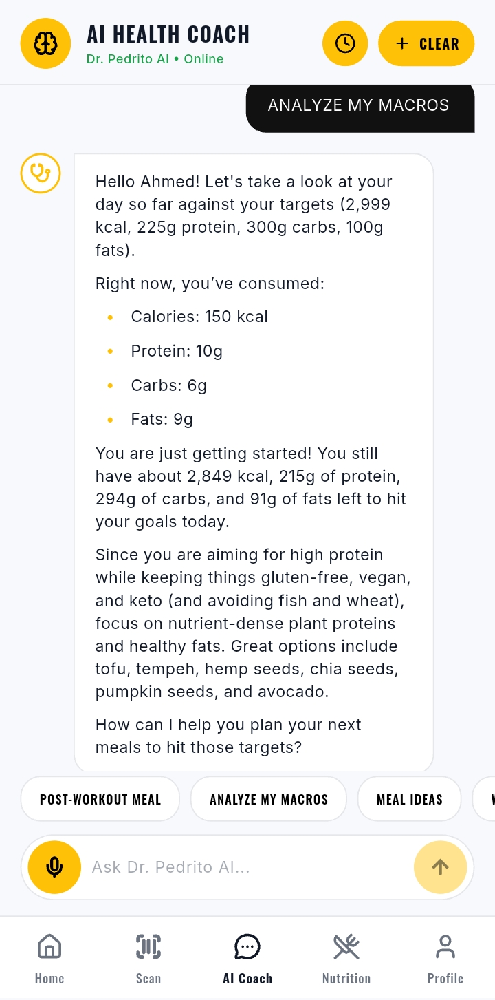 | 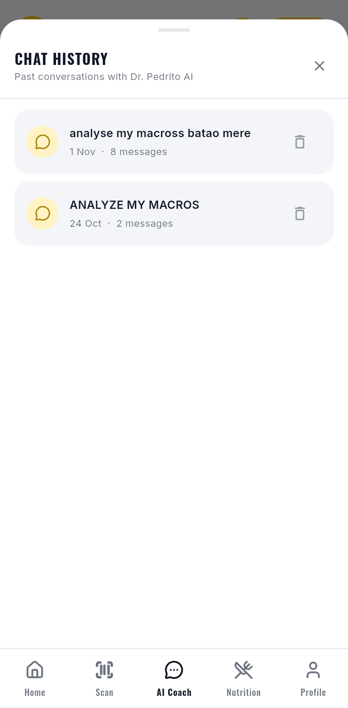 |  |

### Mentor booking
Users can book a consultation with Dr. Pedrito, choosing a plan (Single, Monthly, VIP) and a mode (In-person, Video, WhatsApp). Bookings show status, WhatsApp contact and the doctor's notes.

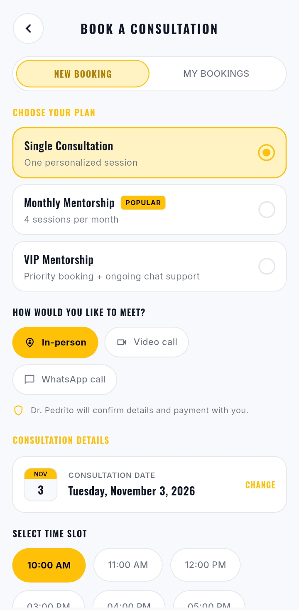

### Profile and membership
- Profile photo with view and remove options, editable health profile and personalised daily targets.
- Dark, Light or System appearance.
- Membership levels (Free, Premium, VIP) managed by the admin.
- Sign in with email or **Continue with Google**.

| Profile (dark) | Profile (light) |
|---|---|
|  | 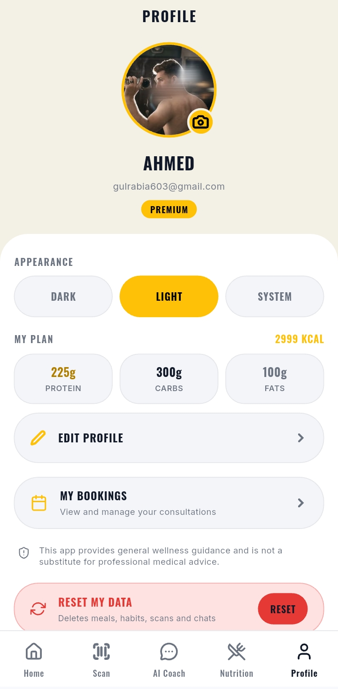 |

## Admin panel

A separate role-protected area for the mentor/admin:

- **Dashboard:** total users, new today, pending bookings, referrals and recent bookings.
- **Bookings:** confirm, complete or cancel consultations and add notes.
- **Users:** view users and set their membership.
- **Referrals, Announcements and Settings:** manage referrals, send in-app announcements and edit the weekly workout plan.

| Dashboard | Bookings | Users and membership |
|---|---|---|
|  |  |  |

## Tech stack

- **Flutter** and **Dart**, Riverpod for state, go_router for navigation
- **Firebase:** Authentication (email and Google), Cloud Firestore with security rules, App Check
- **Gemini** (via Firebase AI) for the coach and food photo analysis
- **Open Food Facts** for barcode product data
- **Cloudinary** for profile photos
- Device sensors and camera: step counter, barcode scanner, image picker, speech to text

## Disclaimer

The app provides general wellness guidance and is not a substitute for professional medical advice. AI food estimates are approximate.

---

Built by <a href="https://github.com/tahirkhan8709">Tahir Khan</a>

